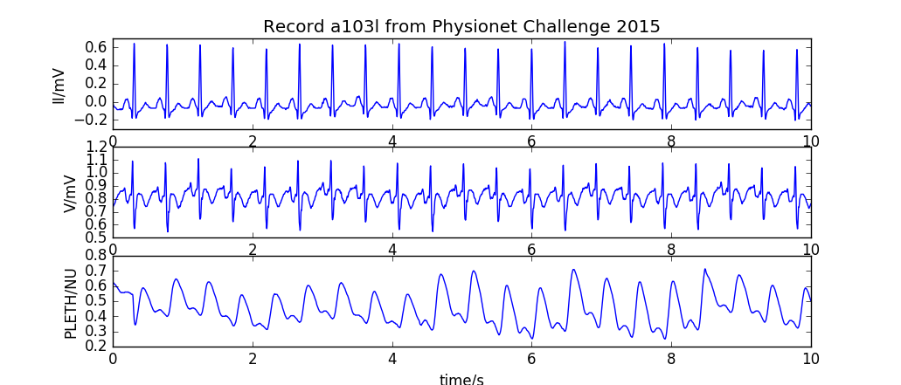

# WFDB for Python

Read, write, plot, and process physiologic waveforms and annotations with
Python. WFDB works with local files and records hosted on
[PhysioNet](https://physionet.org/), so you can move from a published dataset
to NumPy arrays in a few lines of code.

[](https://pypi.org/project/wfdb/)
[](https://wfdb.readthedocs.io/)



## Install

WFDB requires Python 3.11 or newer. Install it from PyPI:

```sh
pip install wfdb
```

If you use [uv](https://docs.astral.sh/uv/), run `uv add wfdb` instead. On
some systems, the `soundfile` dependency also needs a separate installation
of `libsndfile`; see the
[soundfile installation notes](https://pypi.org/project/soundfile/).

## Quick start

Read ten seconds of ECG and its beat annotations from the
[MIT-BIH Arrhythmia Database](https://physionet.org/content/mitdb/):

```python
import wfdb

record = wfdb.rdrecord("100", pn_dir="mitdb", sampto=3600)
annotation = wfdb.rdann("100", "atr", pn_dir="mitdb", sampto=3600)

print(record.fs)  # Sampling frequency: 360 Hz
print(record.sig_name)  # ['MLII', 'V5']
print(record.p_signal.shape)  # (3600, 2): samples x channels
print(annotation.sample[:5])  # Sample positions of the first five annotations

wfdb.plot_wfdb(record=record, annotation=annotation, title="Record 100")
```

The `pn_dir` argument downloads data from PhysioNet. For files already on
your computer, pass the path without its `.hea` or `.dat` extension instead:

```python
record = wfdb.rdrecord("path/to/record")
annotation = wfdb.rdann("path/to/record", "atr")
```

`record.p_signal` is a NumPy array of signals in physical units. Use
`physical=False` with `rdrecord` to read digital values in `record.d_signal`.
Annotations provide sample positions, symbols, and other label information.

## Write a record

Create a WFDB header and signal file from a NumPy array:

```python
import numpy as np
import wfdb

signal = np.array([0.0, 0.2, 0.0, -0.2])[:, None]
wfdb.wrsamp(
    "example",
    fs=250,
    units=["mV"],
    sig_name=["ECG"],
    p_signal=signal,
    fmt=["16"],
)
```

This writes `example.hea` and `example.dat` in the current directory. See
[`wrann`](https://wfdb.readthedocs.io/en/latest/io.html#wfdb.io.wrann)
to write annotations.

## What else can you do?

- **Work with remote data:** Read PhysioNet records with `pn_dir` or a
  `physionet://` URI. Supported cloud URIs include `s3://` and `gs://` when
  the corresponding `fsspec` backend is installed.
- **Use WFDB archives:** Read local `.wfdb` archives containing a record and
  its annotations. See the
  [archive documentation](https://wfdb.readthedocs.io/en/latest/io.html#wfdb-archives).
- **Analyze signals:** Use the
  [processing tools](https://wfdb.readthedocs.io/en/latest/processing.html)
  for tasks such as resampling and QRS detection.
- **Convert formats:** See the
  [conversion guide](https://wfdb.readthedocs.io/en/latest/convert.html)
  for supported waveform formats.

WFDB-Python follows the open
[WFDB specifications](https://github.com/wfdb/wfdb-spec/). It is inspired by
the original [WFDB Software Package](https://physionet.org/content/wfdb/),
but its Python API is documented separately.

## Documentation and help

The [documentation](https://wfdb.readthedocs.io/) covers the full
[I/O API](https://wfdb.readthedocs.io/en/latest/io.html),
[plotting](https://wfdb.readthedocs.io/en/latest/plot.html), and
[processing](https://wfdb.readthedocs.io/en/latest/processing.html). The
[demo notebook](https://github.com/MIT-LCP/wfdb-python/blob/main/demo.ipynb)
shows more examples. Report bugs or request features in the
[issue tracker](https://github.com/MIT-LCP/wfdb-python/issues).

## Contributing and citing

See [DEVELOPING.md](https://github.com/MIT-LCP/wfdb-python/blob/main/DEVELOPING.md)
for setup, testing, and contribution guidance. If you use WFDB-Python in
research, please cite its
[PhysioNet publication](https://physionet.org/content/wfdb-python/).
